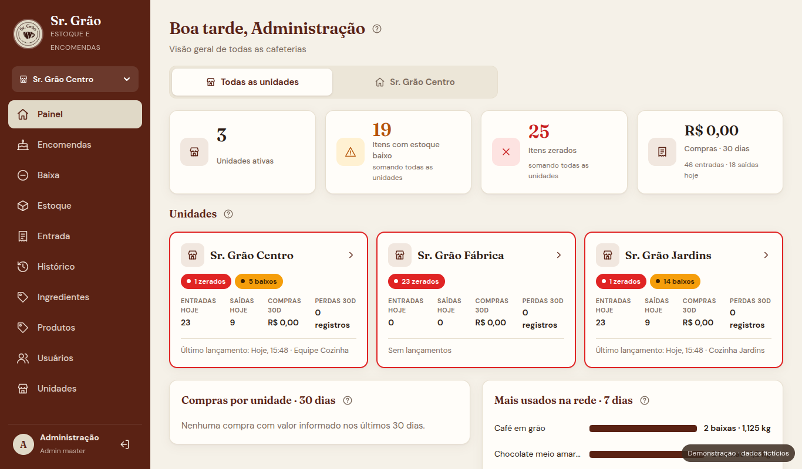
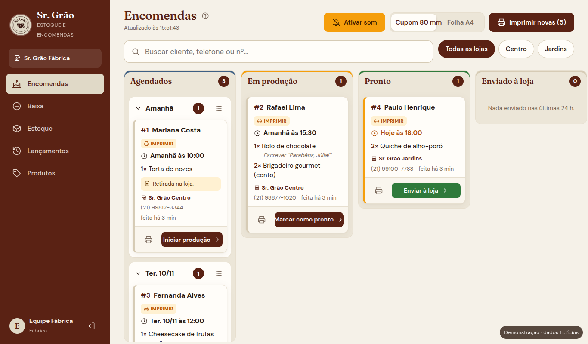
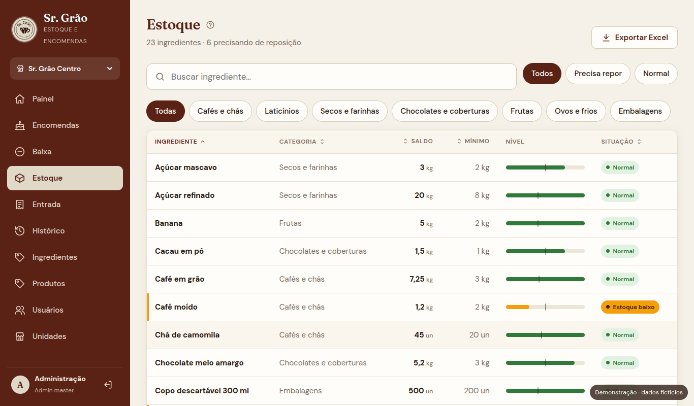
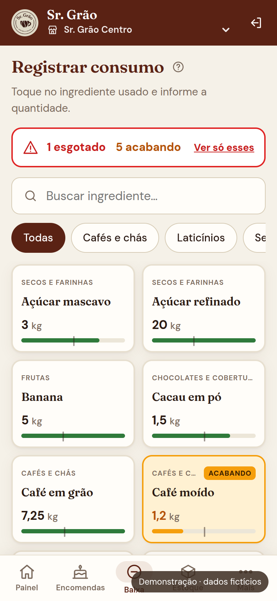

# Sr. Grão — Controle de Estoque e Encomendas

### ▶ [Abrir a demonstração ao vivo](https://foxylyv.github.io/sistema-estoque-encomendas/)

Roda direto no navegador, sem instalar nada: o login já vem preenchido (`admin` / `admin123`).
Também dá para entrar como `fabrica` / `fabrica123` para ver o quadro de produção, ou como
`cozinha` / `cozinha123` para ver a tela da cozinha. A demonstração é **somente leitura**, com dados fictícios.

| Painel da rede | Quadro de encomendas da fábrica |
|---|---|
|  |  |
| **Estoque** | **Celular (tela da cozinha)** |
|  |  |

Sistema web de controle de estoque e encomendas para uma rede de cafeterias (lojas + fábrica),
desenvolvido como projeto freelance e entregue em produção.

> Repositório de portfólio: todos os dados (unidades, usuários, ingredientes, clientes e encomendas)
> são **fictícios**, criados pelo comando `seed`. Nenhum dado real do cliente está aqui.

- **backend/** — Django 5.1 + Django REST Framework + JWT + openpyxl (Excel)
- **frontend/** — React 18 + Vite, responsivo (desktop, tablet e celular), com a identidade visual do Sr. Grão

## Tecnologias e destaques

- API REST em **Django + Django REST Framework**, autenticação **JWT**, permissões por perfil (RBAC) e isolamento de dados por unidade
- Front-end em **React + Vite**, responsivo para desktop, tablet e celular
- Saldo nunca sobrescrito: toda operação gera movimentação auditável, com estorno e bloqueio de linha na transação
- Quadro kanban de encomendas com atualização automática, aviso sonoro e impressão em cupom 80 mm / A4
- Exportação para Excel (openpyxl) e testes automatizados no back-end
- A demonstração online usa o mesmo front-end compilado em modo demo (`VITE_DEMO=1`), com um retrato dos dados do `seed` em `frontend/src/demo/`

## Como rodar (desenvolvimento)

### 1. Backend

```bash
cd backend
python3 -m venv .venv
.venv/bin/pip install -r requirements.txt
.venv/bin/python manage.py migrate
.venv/bin/python manage.py seed          # usuários e ingredientes de exemplo
.venv/bin/python manage.py runserver     # http://127.0.0.1:8000
```

O `seed` cria três unidades de exemplo (as lojas **Sr. Grão Centro** e **Sr. Grão Jardins** e a
**Sr. Grão Fábrica**), produtos e algumas encomendas, e estes usuários:

| Perfil               | Unidade | Usuário    | Senha        |
|----------------------|---------|------------|--------------|
| Admin master         | todas   | `admin`    | `admin123`   |
| Gerente da unidade   | Centro  | `gerente`  | `gerente123` |
| Compras              | Centro  | `compras`  | `compras123` |
| Funcionário          | Centro  | `cozinha`  | `cozinha123` |
| Funcionário          | Jardins | `cozinha2` | `cozinha123` |
| Atendente (encomendas) | Centro | `loja`   | `loja123`    |
| Atendente (encomendas) | Jardins | `loja2` | `loja123`    |
| Fábrica (quadro)     | Fábrica | `fabrica`  | `fabrica123` |

Use `seed --sem-movimentos` para criar só os cadastros, sem entradas e consumos de exemplo.
**Troque as senhas antes de usar em produção.**

### 2. Frontend

```bash
cd frontend
npm install
npm run dev        # http://localhost:5173
```

O Vite redireciona `/api` para o Django. Ele também fica acessível na rede local
(ex.: `http://192.168.0.10:5173`), o que permite testar direto no tablet da cozinha.

### Testes

```bash
cd backend && .venv/bin/python manage.py test
```

## Unidades e permissões

- **Catálogo compartilhado:** ingredientes e categorias são os mesmos para todas as unidades.
- **Saldo e estoque mínimo por unidade:** cada cafeteria tem os seus. Entradas, baixas e
  histórico também são separados por unidade.
- **Funcionários** pertencem a uma unidade e só enxergam essa unidade.
- **Admin master** vê todas e troca a unidade em uso no seletor do menu (cabeçalho `X-Establishment` na API).

Perfis prontos (o master pode personalizar marcando as permissões uma a uma):

| Permissão                         | Funcionário | Compras | Gerente | Master |
|-----------------------------------|:-----------:|:-------:|:-------:|:------:|
| Registrar consumo e perdas        | ✔           | ✔       | ✔       | ✔      |
| Registrar entradas de mercadorias |             | ✔       | ✔       | ✔      |
| Ajustar saldo manualmente         |             |         | ✔       | ✔      |
| Estornar lançamentos              |             |         | ✔       | ✔      |
| Cadastrar ingredientes            |             |         | ✔       | ✔      |
| Ver histórico completo            |             |         | ✔       | ✔      |
| Exportar planilhas (Excel)        |             |         | ✔       | ✔      |
| Gerenciar funcionários da unidade |             |         | ✔       | ✔      |
| Registrar encomendas (loja)       |             |         | ✔       | ✔      |
| Quadro de encomendas (fábrica)    |             |         |         | ✔      |
| Todas as unidades, cadastro de unidades e painel da rede | | |       | ✔      |

Todos podem consultar o estoque. Sem "histórico completo", o usuário vê
apenas os próprios lançamentos. O gerente só cria e edita funcionários da própria
unidade e não pode criar um admin master.

Perfis só de encomendas: **Atendente** (`encomendas`) e **Fábrica** (`baixa` + `producao`).

## Encomendas (lojas → fábrica)

Cada unidade tem um **tipo**: `loja` ou `fabrica` (em Unidades).

- **Loja** (permissão `encomendas`): aba *Encomendas* → *Nova encomenda*. Escolhe os produtos do
  catálogo, preenche cliente, telefone, dia e hora de entrega e observações, confere o resumo e envia.
  **Depois de enviada, a encomenda não pode ser editada.** A loja acompanha o andamento e pode imprimir
  a via do cliente.
- **Fábrica** (permissão `producao`, só vale em unidade do tipo fábrica): a aba *Encomendas* vira um
  quadro com as colunas **Agendados** (agrupados por dia) → **Em produção** → **Pronto** →
  **Enviado à loja**. A tela atualiza a cada 15 s; encomenda nova toca um aviso (clique em
  *Ativar som* ao abrir a tela), ganha a etiqueta *Nova* e aparece no título da aba.
- **Impressão:** comanda individual, *Imprimir novas* (todas as que a fábrica ainda não imprimiu) e
  *Folha do dia* (total por produto + lista). Formato **Cupom 80 mm** ou **Folha A4**, escolhido no
  quadro. A data impressa é sempre a data fixa (nunca "Hoje"/"Amanhã").
- **Cancelar** e **voltar uma etapa**: só a fábrica ou o admin master, abrindo a encomenda. Cancelar
  exige motivo, que a loja também vê.
- **Produtos:** catálogo fixo cadastrado pela fábrica ou pelo master (aba *Produtos*). Produto
  desativado some da tela das lojas; as encomendas antigas guardam o nome da época.
- Cada encomenda tem histórico (registrada, mudanças de andamento, impressão, cancelamento).
- O admin master vê o quadro selecionando a fábrica no seletor de unidade, e registra encomendas
  selecionando uma loja.

Para as lojas e a fábrica se falarem, o sistema precisa estar **hospedado na internet** (ver Produção).

## Regras de negócio

- **Unidade padrão por ingrediente** (kg, g, L, ml, un). Entradas e saídas aceitam unidades
  compatíveis e o sistema converte (ex.: entrada em kg, consumo em g). Unidades de
  dimensões diferentes (kg × L) são recusadas.
- **O saldo nunca é sobrescrito.** Toda operação cria uma movimentação com usuário, data,
  tipo, quantidade e saldo resultante (`inventory/services.py`). O saldo é atualizado na
  mesma transação, com bloqueio de linha para evitar conflito entre tablet e escritório.
- **Correções preservam o histórico:**
  - *Estorno*: cria um lançamento oposto, ligado ao original. Um lançamento só pode ser
    estornado uma vez.
  - *Desfazer (cozinha)*: o funcionário pode desfazer a própria baixa em até 15 minutos.
    Depois disso, só quem tem a permissão de estorno (gerente ou master).
  - *Cancelar entrada*: estorna todos os itens de uma nota.
  - *Ajuste manual*: quem tem a permissão informa o saldo real e o sistema lança a
    diferença, com motivo obrigatório (inventário, correção etc.).
- **Saldo inicial:** ao cadastrar um ingrediente, dá para informar quanto já existe; vira
  um lançamento "Saldo inicial" no histórico.
- **Perdas** são registradas separadamente do consumo, com motivo obrigatório.
- **Saída maior que o saldo:** bloqueada por padrão, com alerta na tela. Para permitir saldo
  negativo, defina `ESTOQUE_PERMITIR_SALDO_NEGATIVO=true`.
- A unidade padrão de um ingrediente não pode mudar depois que ele já tem movimentações.

## API (resumo)

| Método | Rota                                | Descrição                                |
|--------|-------------------------------------|------------------------------------------|
| POST   | `/api/auth/token/`                  | Login (retorna JWT)                      |
| GET    | `/api/auth/me/`                     | Usuário logado                           |
| GET    | `/api/dashboard/`                   | Painel da unidade em uso                 |
| GET    | `/api/dashboard/rede/`              | Painel consolidado de todas as unidades (master) |
| CRUD   | `/api/categories/`                  | Categorias                               |
| CRUD   | `/api/ingredients/?status=alerta`   | Ingredientes (filtros: categoria, situação, busca) |
| GET/POST | `/api/entries/`                   | Entradas por nota fiscal (com itens)     |
| POST   | `/api/entries/{id}/cancelar/`       | Cancela a entrada (estorno dos itens)    |
| GET    | `/api/movements/`                   | Histórico (filtros: tipo, período, usuário, ingrediente; `ordering`) |
| GET    | `/api/movements/export/`            | Histórico em Excel (mesmos filtros)      |
| GET    | `/api/ingredients/export/`          | Estoque em Excel                         |
| CRUD   | `/api/establishments/`              | Unidades (escrita só para o master)      |
| CRUD   | `/api/users/`                       | Usuários (master ou gerente da unidade)  |
| POST   | `/api/movements/saida/`             | Baixa de consumo ou perda                |
| POST   | `/api/movements/ajuste/`            | Ajuste por inventário físico             |
| POST   | `/api/movements/{id}/estornar/`     | Estorno de um lançamento                 |
| CRUD   | `/api/products/`                    | Catálogo de produtos da fábrica          |
| GET/POST | `/api/orders/`                    | Encomendas (filtros: `quadro`, `ativas`, `status`, `loja`, `de`, `ate`, `search`; `todas=1` sem paginação) |
| POST   | `/api/orders/{id}/andamento/`       | Muda o andamento (fábrica)               |
| POST   | `/api/orders/{id}/cancelar/`        | Cancela com motivo (fábrica)             |
| POST   | `/api/orders/impressas/`            | Marca encomendas como impressas (fábrica)|

## Produção

Variáveis de ambiente do backend:

| Variável                            | Padrão                        |
|-------------------------------------|-------------------------------|
| `DJANGO_SECRET_KEY`                 | chave de desenvolvimento (troque!) |
| `DJANGO_DEBUG`                      | `true`                        |
| `DJANGO_ALLOWED_HOSTS`              | `localhost,127.0.0.1,0.0.0.0` |
| `CORS_ALLOWED_ORIGINS`              | `http://localhost:5173`       |
| `POSTGRES_DB`, `POSTGRES_USER`, `POSTGRES_PASSWORD`, `POSTGRES_HOST`, `POSTGRES_PORT` | se `POSTGRES_DB` estiver definido, usa PostgreSQL (instale `psycopg[binary]`); senão, SQLite |
| `ESTOQUE_PERMITIR_SALDO_NEGATIVO`   | `false`                       |

Frontend: `npm run build` gera `frontend/dist/`. Se a API estiver em outro domínio,
defina `VITE_API_URL=https://api.seudominio.com/api` antes do build.

## Fora do escopo desta versão

Importação de XML de NF-e, código de barras/QR Code, baixa automática por ficha técnica,
lote/validade, integrações com ERP/PDV e modo offline.
